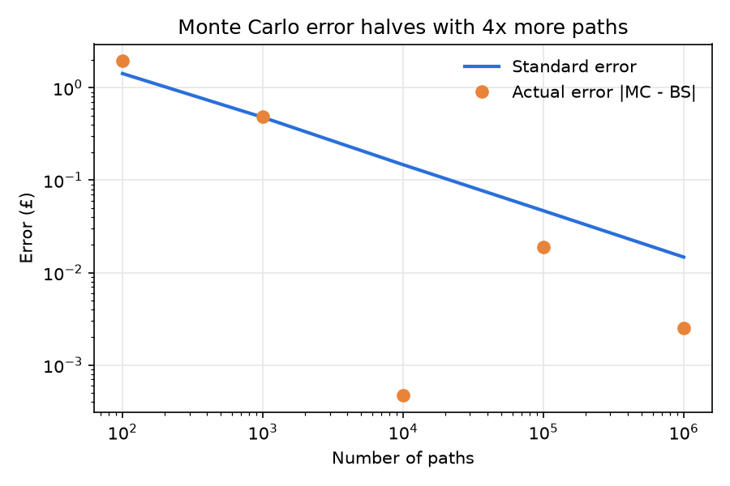

# mcframe

A test of Monte Carlo simulations framework. 

Built on PyTorch. Models never generate their own random numbers: the engine draws them from a seed and passes them in, so the same seed always gives the same paths.

## Status

This is a working framework: any model can be plugged in, as long as it follows the `PathModel` format in `src/mcframe/models/base.py`:

- `dim`: how many numbers describe one state
- `noise_dim`: how many random numbers one step needs
- `init_state(x0, n_paths)`: returns the starting state of every path, `(n_paths, dim)`
- `step(x, a, z, dt)`: returns the next states, `(n_paths, dim)`, using only the noise `z` it is given

`simulate` runs the model forward and returns a `Paths` object. An optional action plan can be passed in, either shared by every path `(horizon, a_dim)` or one per path `(n_paths, horizon, a_dim)`.

**No statistical handling has been done yet.** There are no hit probabilities, error bars, confidence intervals or scenario comparisons; these still need to be added.

## Checking a new model

`check_model` checks whether a model will work in the pipeline. Call it on your model before a real run:

```python
from mcframe import check_model

check_model(my_model, x0)  # x0: a valid starting state for the model
```

It raises `ModelCheckError` naming the first check that failed, and returns nothing if all pass. It checks that:

- the model follows the `PathModel` format
- `init_state` returns `(n_paths, dim)`
- `step` returns `(n_paths, dim)` and does not change its input
- the same seed gives identical paths through `simulate`
- a short run produces no NaN or infinite values

## Pricing a European call

`examples/01_european_option.py` simulates a stock with geometric Brownian motion and prices a one-year call option (S0 = 100, K = 100, r = 5%, σ = 20%, 252 daily steps, 100,000 paths). The result is checked against the exact Black–Scholes price:

| | Price |
|---|---|
| Monte Carlo | 10.4250 ± 0.0465 |
| Black–Scholes | 10.4506 |
| Difference | 0.0256 (0.55 standard errors) |

The error shrinks with the square root of the number of paths, as expected:



## Running it

```
pip install -e .
python examples/01_european_option.py
```

Claude used for easy updates to the repo.
